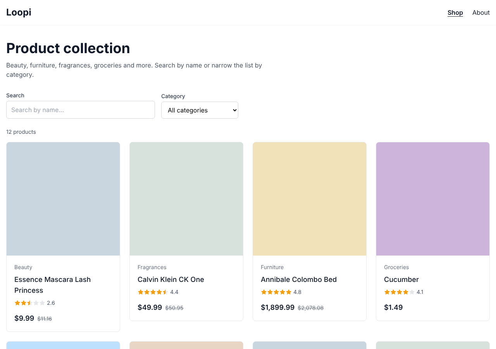

# Loopi

A demo online shop built with React. It loads the full catalogue from the [DummyJSON products API](https://dummyjson.com/docs/products), with search, category filters and a detail page for every product.

**Live demo:** https://loopi.vercel.app



## Features

- **Full catalogue** of almost 200 products, loaded in a single request with only the fields the list needs.
- **Search and category filter** that work together, with a live result count and a "Clear filters" shortcut.
- **Product page** with an image gallery, real ratings and review count, discount, stock, shipping and return details.
- **Loading, empty, error and "not found" states**, announced to screen readers, with a retry button when the API fails.
- **Shareable links.** Every product has its own URL that works when opened directly or after a refresh.
- **Accessible.** Labelled form fields, keyboard-friendly gallery thumbnails, a skip link and an active state in the navigation.

## Tech

- React 19 with Vite
- React Router 7
- Tailwind CSS
- Axios, wrapped in a small service layer (`src/services/api.js`)
- Deployed on Vercel

## Project structure

```
src/
├── components/   # Header, Footer, ProductCard, SearchBar, CategoryFilter, Rating, StatusMessage
├── pages/        # Home, ProductDetail, About
├── services/     # API calls
└── utils/        # Price and category formatting
```

## Running it

```bash
npm install
npm run dev       # http://localhost:8010
npm run build     # production build in dist/
```
